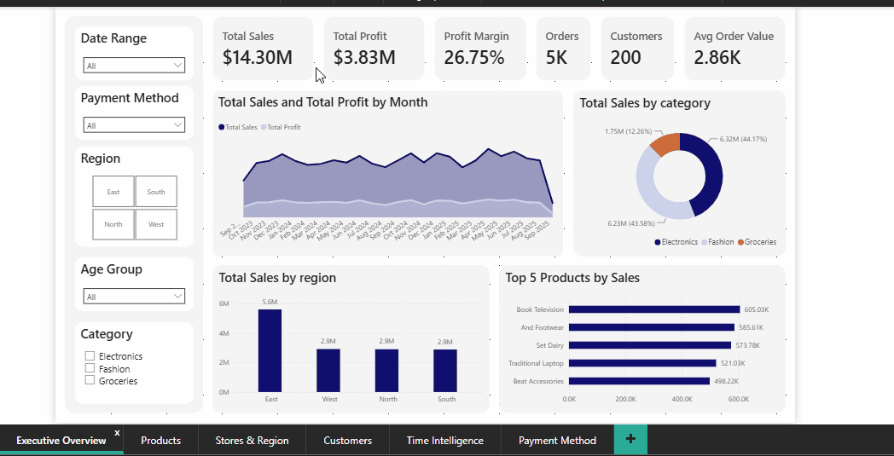
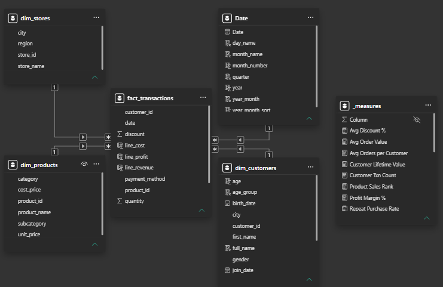
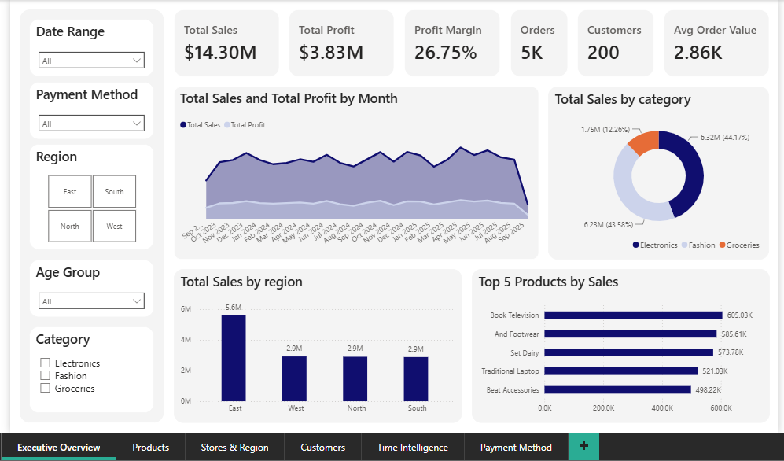
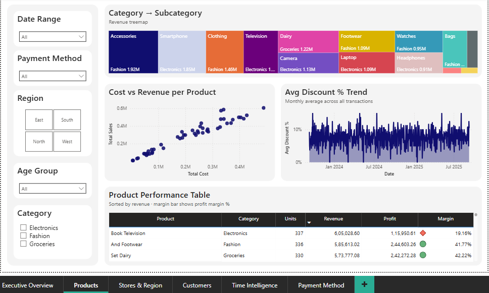
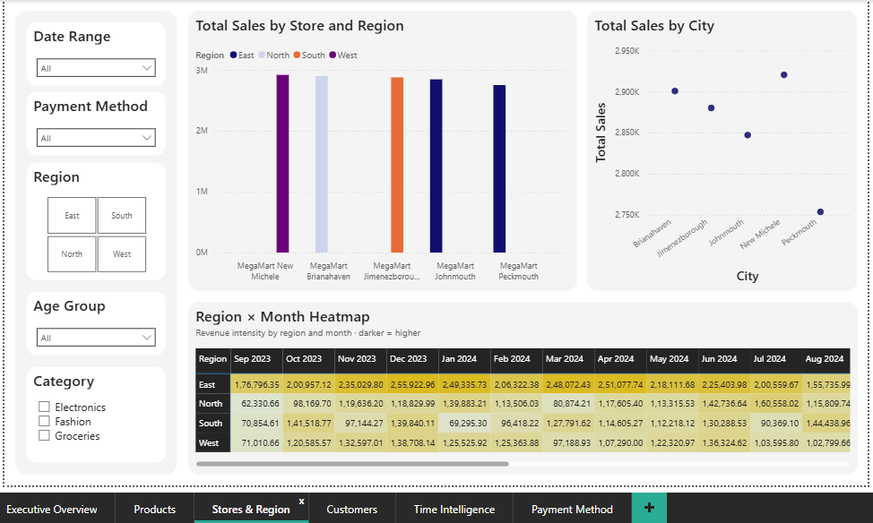
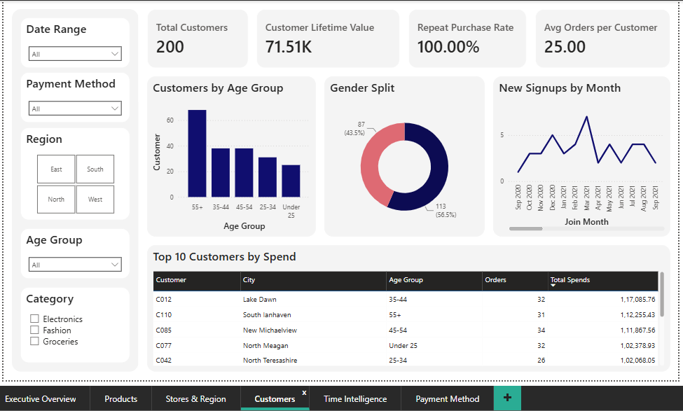
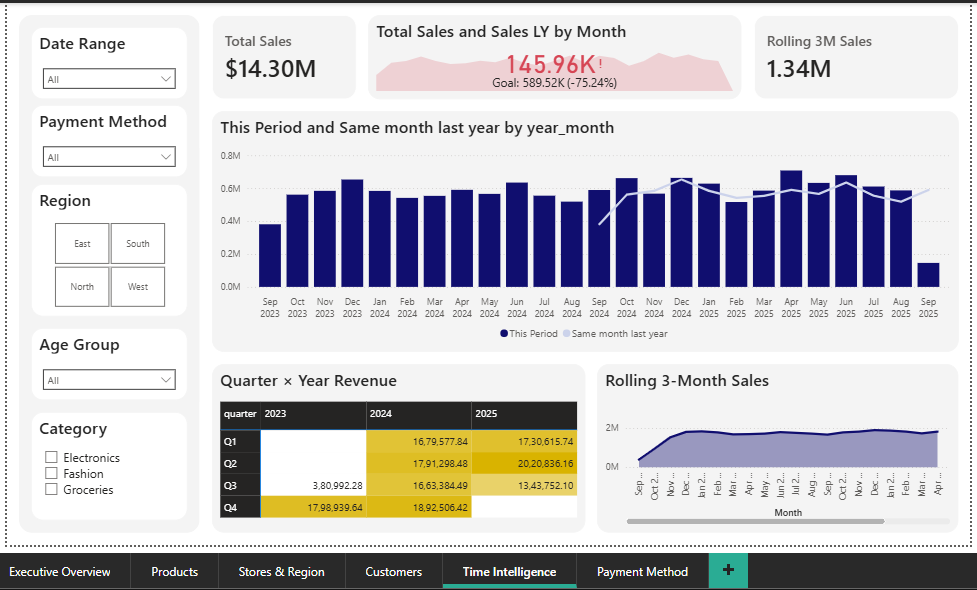
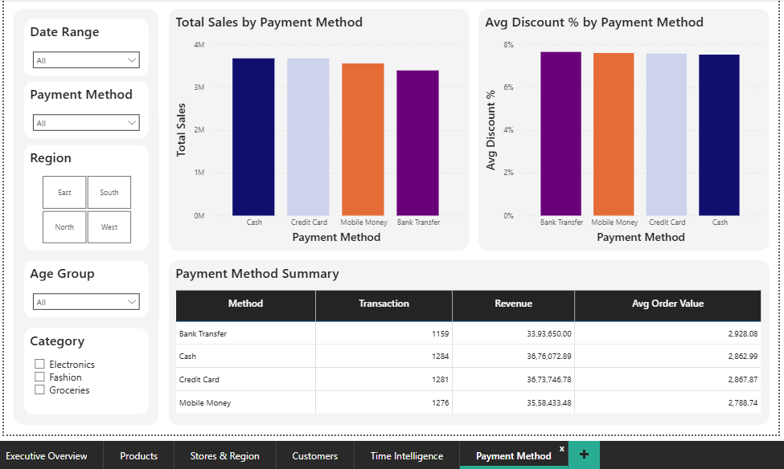

# MegaMart Retail Sales Dashboard

An interactive Power BI dashboard analyzing retail sales performance across 5 stores, 200 customers, and 50 products over a 2-year period (Sep 2023 - Sep 2025). Built as a hands-on project to practice data modelling, DAX, and dashboard design.

## Dashboard Demo
 

## Overview

This project takes a raw, multi-table retail dataset through the full BI workflow: data cleaning, star schema modelling, DAX measure development, and interactive report design. It includes six report pages, 20+ DAX measures, and cross-filtered slicers throughout.

**Source data:** [Retail Sales Dataset](dataset/retail_sales_dataset.xlsx) *(adapted into a multi-table structure for this project)*

## Key Business Insights

- **Category Performance:** Electronics (44.17%) and Fashion (43.58%) generate 87.75% of total revenue. However, Groceries has the highest profit margin at 30.44%.

- **Regional Performance:** East leads revenue with $5.60M, but West has higher average sales per store ($2.92M vs. $2.80M).

- **Product Profitability:** Book Television leads in revenue ($605K), while And Footwear delivers a significantly higher profit margin (41.77%).

- **Sales Growth:** January-August sales increased by 8.9% in 2025 compared with the same period in 2024.

- **Payment Trends:** Revenue is distributed fairly evenly across all four payment methods, with Cash contributing the largest share (25.70%).

**Key Takeaway:** Revenue concentration, product profitability, store-level performance, and comparable-period growth are the main areas highlighted by this analysis.

## Data Preparation

The Excel workbook was imported into Power BI, where the four tables were organized into a relational data model.

- **Data Preparation:** Reviewed column data types and prepared the tables for analysis.
- **Data Modelling:** Used Transactions as the fact table, with Customers, Products, and Stores as dimension tables.
- **Date Table:** Created a dedicated calendar table to support time-based analysis and YoY comparisons.

## Data Model

Star schema with one fact table and three dimension tables, plus a dedicated date dimension for time intelligence.



| Table | Grain | Rows |
|---|---|---|
| `fact_transactions` | One row per line item | 5,000 |
| `dim_customers` | One row per customer | 200 |
| `dim_products` | One row per product | 50 |
| `dim_stores` | One row per store | 5 |
| `Date` | One row per calendar day | ~730 |

## Key DAX Measures

Organized into display folders inside a dedicated `_measures` table:

- **Core** - `Total Sales`, `Total Profit`, `Profit Margin %`, `Avg Order Value`, `Total Transactions`
- **Time Intelligence** - `Sales YoY %`, `Sales MTD`, `Sales YTD`, `Rolling 3M Sales`
- **Customer** - `Customer Lifetime Value`, `Repeat Purchase Rate`, `Avg Orders per Customer`
- **Rank** - `Product Sales Rank`, `Store Sales Rank`, `Top 10 Flag`

Example:
```dax
Total Sales =
SUMX(
    fact_transactions,
    fact_transactions[quantity]
    * RELATED(dim_products[unit_price])
    * (1 - fact_transactions[discount])
)
```

## Report Pages

| Page | What it shows |
|---|---|
| **Executive Overview** | Company-wide KPIs, monthly sales trend, category and region breakdown |
| **Products** | Top/bottom performers, cost vs. revenue, category-subcategory treemap, discount trends |
| **Stores & Region** | Store and city-level performance, region × month sales heatmap |
| **Customers** | Demographics, lifetime value, repeat purchase rate, top spenders |
| **Time Intelligence** | YoY comparison, rolling averages, quarter × year matrix |
| **Payment Method** | Sales and discount behavior split by payment type |

All pages share a `synced filter` panel (region, category, payment method, age group, date range), selections made on any page apply across the whole report.

## Screenshots

<details open>
<summary>View all pages</summary>








</details>

## Running This Yourself

1. Clone or download this repository.
2. Open `retail_sales_dashboard.pbip` in Power BI Desktop.
3. On the first refresh, select Anonymous authentication if Power BI requests credentials for GitHub.
4. Refresh the report.

---

*Built as a learning project, feedback is welcome.*